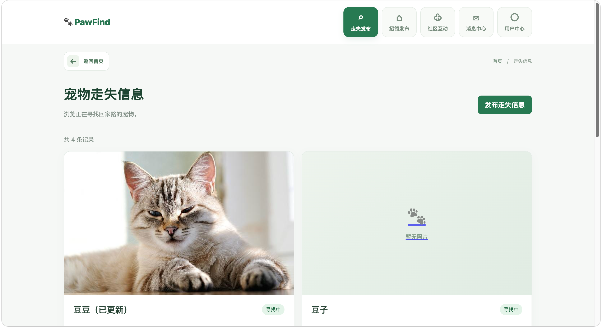
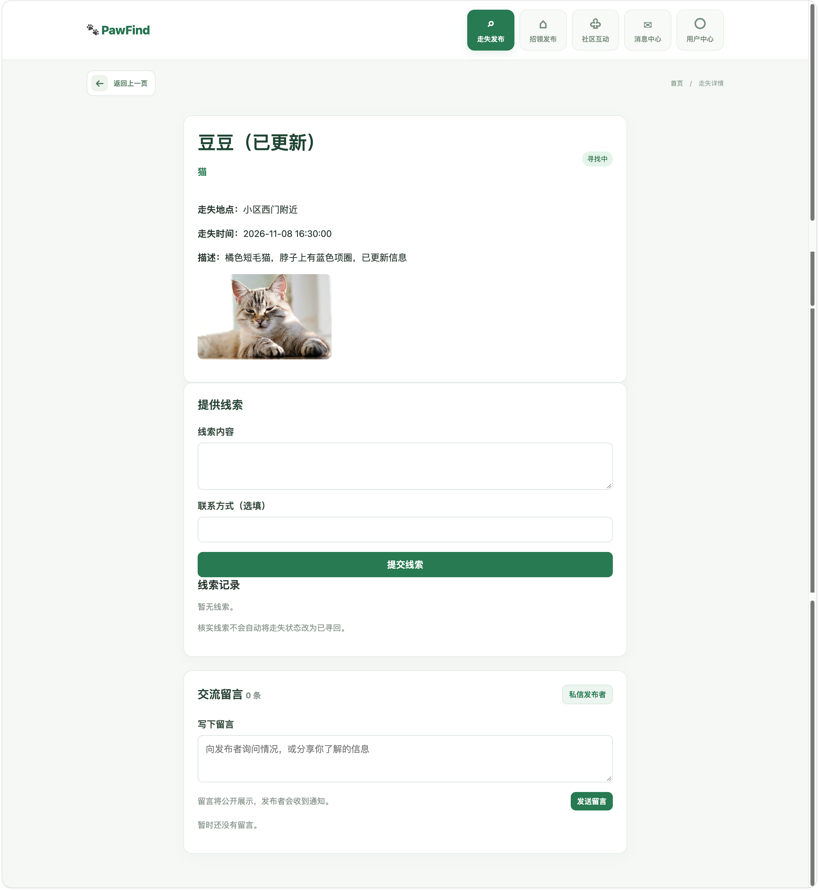
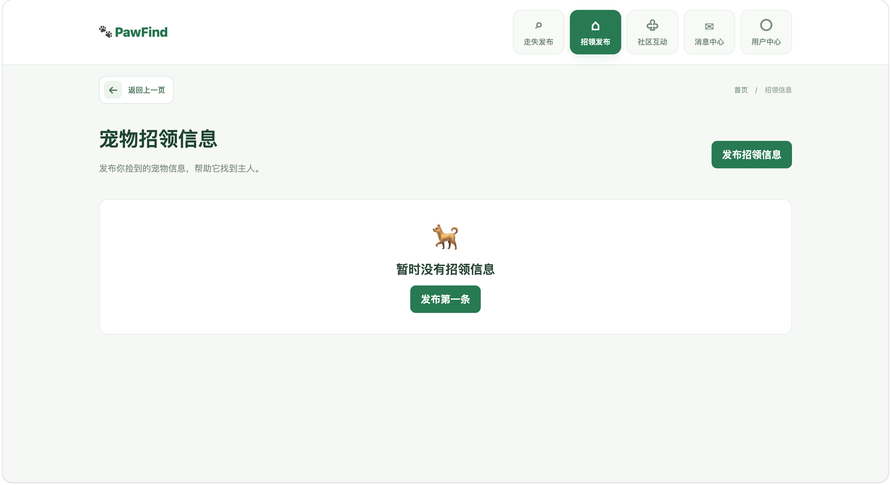
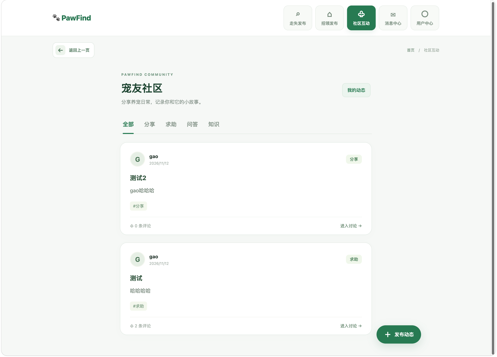
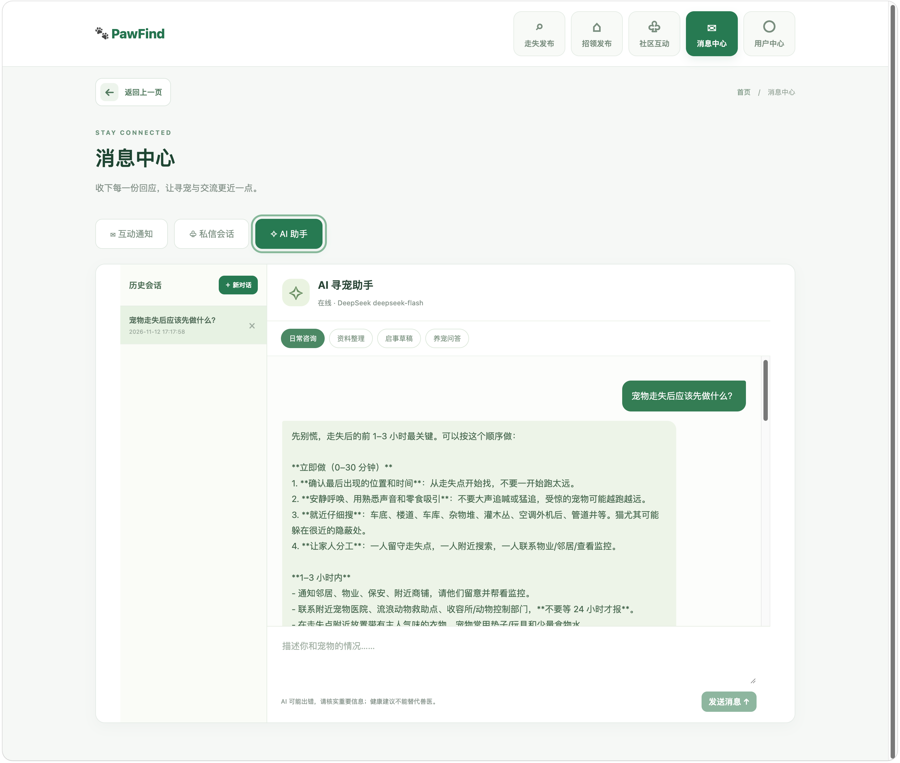
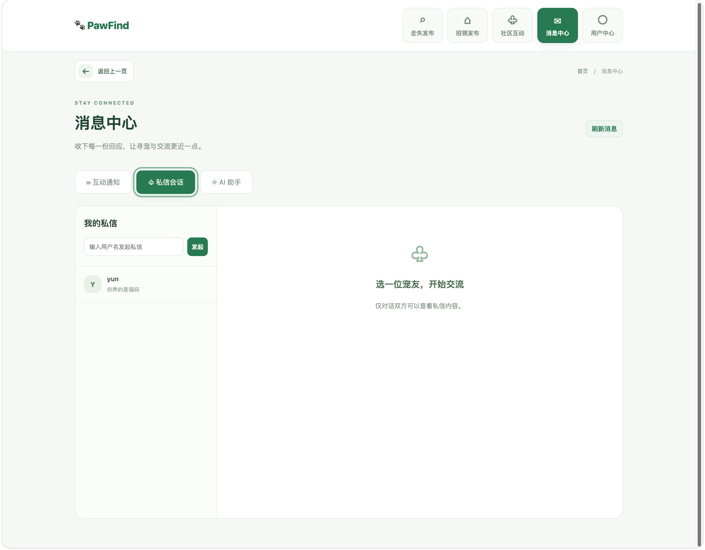
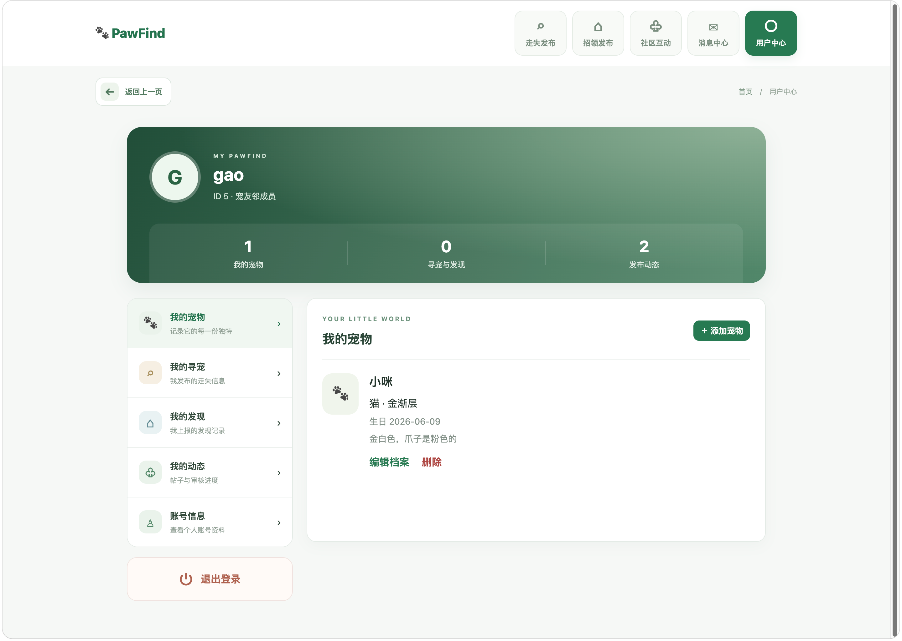
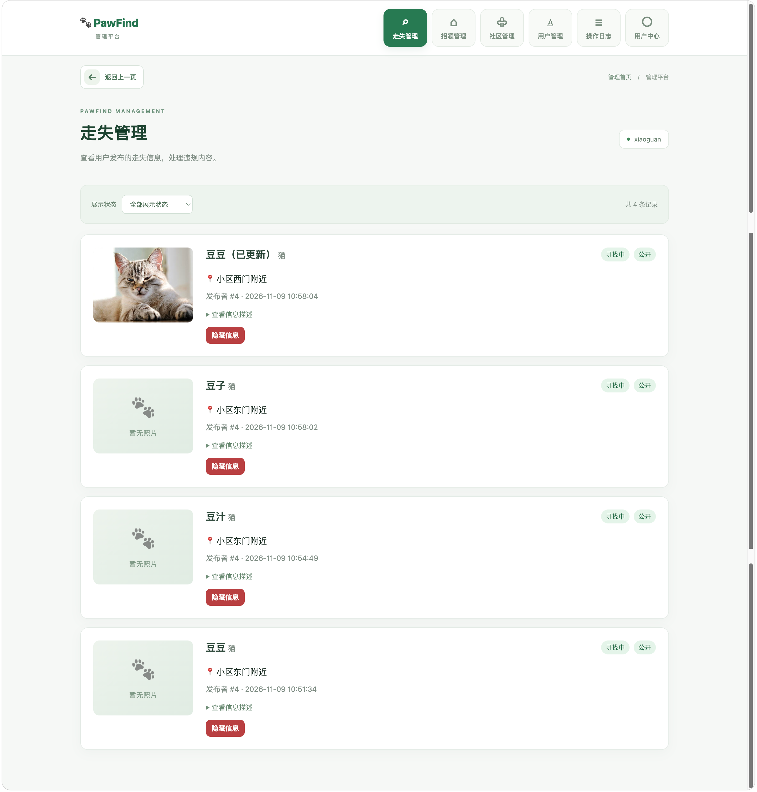
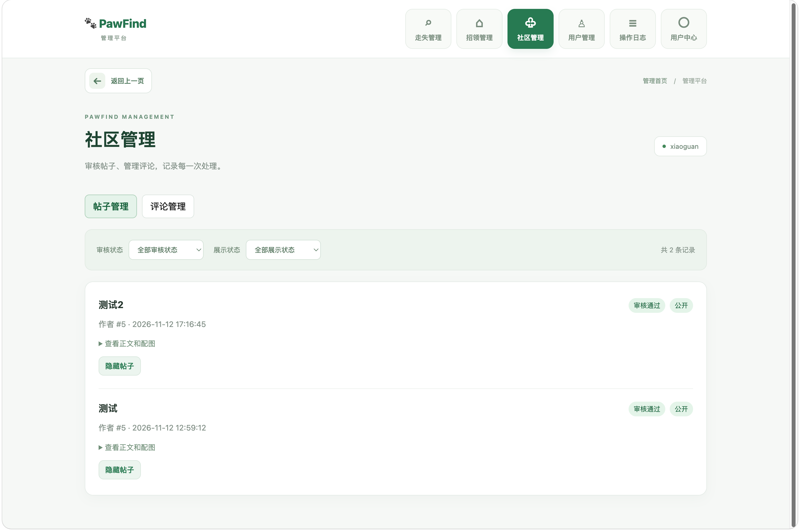
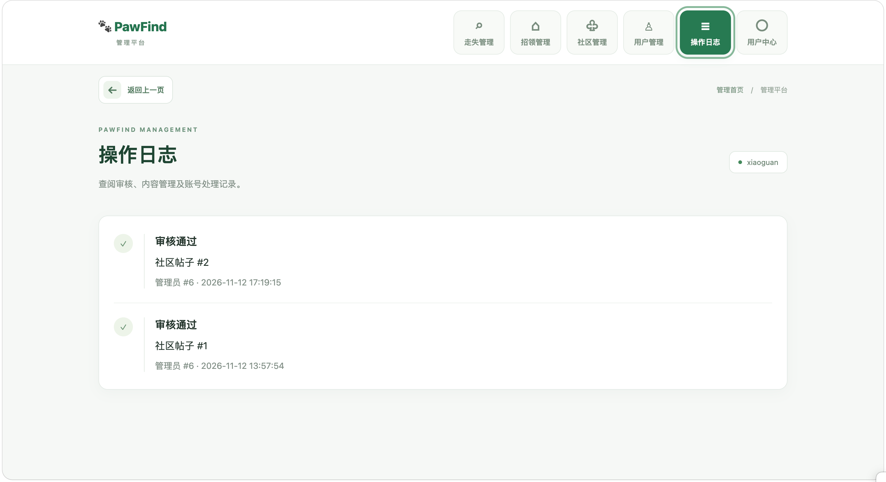

# 🐾 PawFind — 宠物寻回与社区互助平台

基于 **Spring Boot + Vue 3 + Spring AI + DeepSeek** 构建的全栈宠物寻回平台，集宠物走失发布、招领信息、目击线索、社区互动、站内消息和 AI 智能助手于一体。

> 一个面向社区宠物主人的全栈实战项目，重点实践 Java 后端业务开发、用户认证与权限控制、关系型数据库设计以及大模型应用集成。

## 📖 项目简介

PawFind 是一个面向社区居民的宠物走失与寻回平台。

当宠物走失时，用户可以发布走失信息、上传宠物照片、补充特征和走失地点；发现疑似走失宠物的用户可以发布招领信息或提供目击线索。平台同时提供社区互动、私信沟通、站内通知和管理后台，帮助用户更方便地交换信息。

在传统业务功能之外，项目集成了基于 Spring AI 和 DeepSeek 的 AI 寻宠助手，支持多模式对话、聊天记录持久化以及 SSE 流式响应。

项目采用前后端分离架构，围绕真实业务场景实现从身份认证、数据存储、业务权限到 AI 对话的完整开发流程。

## 🛠️ 技术栈

| 分类 | 技术 |
| --- | --- |
| 后端语言 | Java 25 |
| 后端框架 | Spring Boot 4.0.9 |
| 数据访问 | MyBatis-Plus、MyBatis |
| 数据库 | MySQL 8.4 |
| 身份认证 | JWT、BCrypt |
| AI 应用 | Spring AI、DeepSeek |
| 流式通信 | Server-Sent Events（SSE） |
| 前端框架 | Vue 3、TypeScript、Vite |
| 项目构建 | Maven Wrapper、npm |
| 开发工具 | Cursor、Navicat、Git、GitHub |

## ✨ 核心功能

### 1. 宠物走失与招领

- 用户可以发布走失和招领信息，填写宠物特征、时间、地点等内容。
- 支持上传宠物图片，并关联保存图片附件信息。
- 提供走失与招领信息列表和详情页面。
- 支持发布者编辑、撤回个人记录。
- 游客可以浏览公开的走失和招领信息。

### 2. 目击线索管理

- 用户可以针对走失宠物提交目击线索。
- 走失信息发布者可以查看和核实相关线索。
- 对线索内容和联系方式进行数据可见性控制。
- 仅允许相关发布者、线索提交者及管理员访问授权范围内的信息。

### 3. 宠物社区

- 支持分享、求助、问答和知识等不同类型的社区内容。
- 用户可以发布图文帖子、浏览帖子及参与评论。
- 支持帖子审核及审核状态查询。
- 修改后的帖子需要重新审核，审核通过且可见的内容才会公开展示。

### 4. 消息中心与私信

- 支持站内通知和用户之间的私信沟通。
- 根据走失、招领、寻宠线索、社区评论等业务互动生成通知。
- 支持从用户信息或业务详情页发起私信。
- 限制私信读取范围，仅允许会话相关用户访问。

### 5. 用户中心

- 支持用户注册、登录及个人信息管理。
- 提供宠物档案管理。
- 支持查看个人发布的走失记录、招领记录和社区动态。
- 基于用户身份控制个人数据的查询和修改权限。

### 6. 管理后台

- 提供独立的管理员操作界面。
- 支持走失与招领信息管理。
- 支持社区帖子审核、评论管理。
- 支持用户账号禁用与恢复。
- 记录管理员操作日志，便于追踪关键管理行为。

### 7. AI 寻宠助手

通过 Spring AI 接入 DeepSeek，为用户提供智能对话能力：

- 日常咨询
- 寻宠资料整理
- 寻宠启事草稿生成
- 养宠知识问答

AI 聊天记录按用户和会话保存在 MySQL 中，支持历史会话恢复，并提供普通响应和 SSE 流式响应接口。

## 🧠 后端与 AI 技术亮点

### JWT 身份认证与角色权限控制

基于 JWT 实现用户身份认证，使用 BCrypt 对用户密码进行哈希存储。

项目区分普通用户和管理员角色，并在业务层控制数据访问权限，例如：

- 普通用户只能修改自己发布的业务记录。
- 目击线索及联系方式仅向授权用户开放。
- 私信内容只能由对应会话参与者读取。
- 管理员可以执行审核、用户管理等特权操作。

通过这些规则，将身份认证与业务数据权限结合，而不仅仅是限制前端页面入口。

### 基于 MyBatis-Plus 的业务数据访问

使用 MyBatis-Plus 和 MyBatis 完成数据库访问，实现用户、走失记录、招领记录、线索、社区、消息和 AI 会话等模块的数据持久化。

针对不同业务场景实现分页查询、条件筛选、记录状态管理及关联数据读取。

### 审核流程与事务一致性

社区内容采用审核机制，对帖子发布、修改和可见状态进行管理。

管理员执行相关状态变更时，将业务记录更新与操作日志写入放在同一事务中处理，避免业务状态已修改但审计记录未保存的情况。

### AI 多会话管理与历史持久化

基于 Spring AI 接入 DeepSeek，将大模型能力整合到宠物寻回业务中。

AI 模块支持：

- 按用户区分聊天会话
- 多轮对话上下文管理
- MySQL 持久化聊天消息
- 恢复历史会话
- 面向不同任务的对话模式

通过这些能力，将一次性的模型调用扩展为可持续使用的 AI 聊天功能。

### SSE 流式响应

AI 模块同时提供普通对话接口和 SSE 流式对话接口。

流式模式下，后端可以逐步向前端推送模型生成内容，减少用户等待完整响应的时间，改善聊天过程中的交互体验。

### 文件上传与附件管理

支持宠物图片和社区配图上传，将附件信息保存在数据库中，并通过本地文件目录保存实际图片。

业务记录与图片附件建立关联，使图片能够在列表和详情页面中展示。

## 🖼️ 项目展示

以下截图来自本地运行的 PawFind 项目。

### 宠物走失信息发布



### 宠物图片上传



### 宠物招领



### 社区互动



### AI 寻宠助手



### 消息与私信



### 用户中心



### 管理后台 — 走失信息管理



### 管理后台 — 社区审核



### 管理后台 — 操作日志



## 📁 项目结构

```text
PawFind/
├── backend/                 # Spring Boot 后端
│   ├── src/
│   │   ├── main/
│   │   │   ├── java/        # Java 业务代码
│   │   │   └── resources/   # 应用配置与资源
│   │   └── test/            # 后端测试
│   └── mvnw                 # Maven Wrapper
│
├── frontend/                # Vue 3 前端
│   ├── src/                 # 页面、组件与业务逻辑
│   └── package.json
│
├── database/                # 数据库初始化与迁移
│   ├── pawfind.sql
│   └── migrations/
│
├── docs/                    # 项目文档
│   ├── api/                 # 接口说明
│   └── screenshots/         # 页面截图
│
├── .gitignore
└── README.md
```

## 🚀 本地运行

目前项目以本地开发环境运行，需要自行准备数据库及相关环境变量。

### 1. 环境要求

- Java 25
- MySQL 8.4
- Node.js 和 npm
- Git

后端通过 Maven Wrapper 构建，无需单独安装 Maven。

### 2. 初始化数据库

首先在 MySQL 中创建一个空数据库：

```sql
CREATE DATABASE pawfind
CHARACTER SET utf8mb4
COLLATE utf8mb4_unicode_ci;
```

然后导入项目中的初始化脚本：

```text
database/pawfind.sql
```

**注意：初始化脚本包含删表语句，请只在空数据库中使用，不要直接导入已有业务数据的数据库。**

对于已有数据库，请按编号顺序执行尚未应用的迁移脚本。

当前最新迁移为：

```text
database/migrations/004_deepseek_ai_chat.sql
```

后端默认使用 `pawfind_app` 数据库账号，请确保该账号已经创建、具有 `pawfind` 数据库所需的读写权限，并且密码正确。

### 3. 启动后端

进入后端目录：

```bash
cd backend
```

在当前终端中设置数据库密码：

```bash
read -rs "DB_PASSWORD?请输入 MySQL 密码: "
echo
export DB_PASSWORD
```

设置 JWT 密钥：

```bash
export JWT_SECRET="$(openssl rand -base64 32)"
```

启动 Spring Boot：

```bash
./mvnw spring-boot:run
```

后端默认地址：

```text
http://localhost:8080
```

**安全说明：**

- 不要将数据库密码或 JWT 密钥直接写入 Git 仓库。
- 示例命令每次启动都会生成新的 JWT 密钥，因此旧登录令牌可能失效。
- 本地上传图片默认保存到 `backend/uploads/`，迁移已有数据时需要同时保留数据库附件记录和图片文件。

### 4. 启动前端

新开一个终端，进入前端目录：

```bash
cd frontend
```

安装依赖：

```bash
npm ci
```

启动开发服务器：

```bash
npm run dev
```

前端默认地址：

```text
http://localhost:5173
```

在浏览器打开上述地址，即可访问 PawFind。

### 5. 初始化管理员账号

先通过前端注册一个专用用户账号。

然后使用具有相应权限的数据库账号执行：

```sql
UPDATE sys_user
SET role = 'ADMIN'
WHERE username = 'your_admin_username';
```

将 `your_admin_username` 替换为实际用户名。

重新登录后，即可使用管理员功能。

> 此方式用于本地开发环境的管理员初始化。实际部署时应采用更严格的管理员账号初始化与授权方式。

## 🤖 DeepSeek AI 配置

AI 功能需要配置 DeepSeek API Key。

首先在 DeepSeek 开放平台创建自己的 API Key，然后在启动后端的终端中设置：

```bash
read -rs "DEEPSEEK_API_KEY?请输入 DeepSeek API Key: "
echo
export DEEPSEEK_API_KEY
```

配置聊天模型：

```bash
export SPRING_AI_MODEL_CHAT=deepseek
export DEEPSEEK_MODEL=deepseek-flash
```

确保当前终端已经设置 `DB_PASSWORD` 和 `JWT_SECRET`，然后启动后端：

```bash
./mvnw spring-boot:run
```

模型名称可以通过 `DEEPSEEK_MODEL` 调整。

**注意：**

- API Key 仅保存在本地运行环境中，不要提交到 GitHub。
- 不要将真实 API Key 填写进 `application.properties`、README 或截图。
- 未配置 DeepSeek API Key 时，其他普通业务模块仍可正常使用。

AI 接口、会话接口和 SSE 事件约定详见：

[消息与 AI 接口文档](docs/api/messages-and-ai-api.md)

## 🔐 业务权限说明

项目对公开数据和用户私有数据采用不同的访问规则。

| 业务 | 权限说明 |
| --- | --- |
| 走失及招领列表 | 游客可以访问公开内容 |
| 发布业务信息 | 需要用户登录 |
| 编辑和撤回记录 | 仅记录发布者可操作 |
| 目击线索 | 仅授权用户及管理员可访问 |
| 线索核实 | 由对应走失信息发布者执行 |
| 社区发帖 | 用户登录后发布，内容需审核 |
| 社区评论 | 对审核通过且可见的帖子开放 |
| 私信 | 仅对应会话参与者可读取 |
| 用户管理 | 管理员权限 |
| 审核与操作日志 | 管理员权限 |

## 📚 相关文档

- [数据库初始化脚本](database/pawfind.sql)
- [数据库迁移脚本](database/migrations/)
- [消息与 AI 接口文档](docs/api/messages-and-ai-api.md)
- [项目文档目录](docs/)

## 🎯 项目实践与收获

PawFind 是一个以实际业务场景为驱动的个人全栈项目，重点实践了：

- Spring Boot 项目的模块化业务开发
- MySQL 数据建模与 MyBatis 数据访问
- JWT 认证和基于业务规则的数据权限控制
- 多模块业务状态管理与事务处理
- Vue 3 与 Spring Boot 的前后端分离协作
- Spring AI 与 DeepSeek 大模型集成
- AI 多轮会话、历史消息持久化和 SSE 流式交互
- 使用 Git 进行版本管理和项目持续迭代

项目当前以本地运行和功能演示为主，后续将持续完善测试、部署与工程化能力。

---

**PawFind · 让每一份寻找，都多一份希望。** 🐾