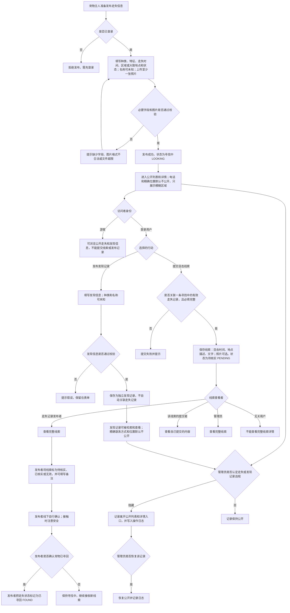
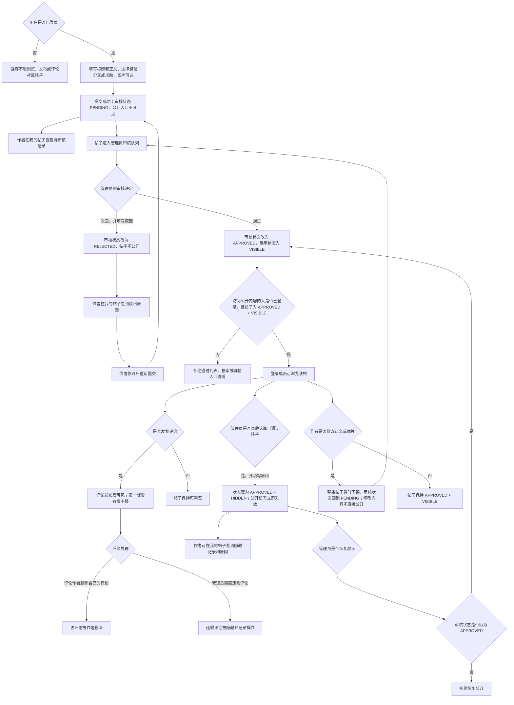
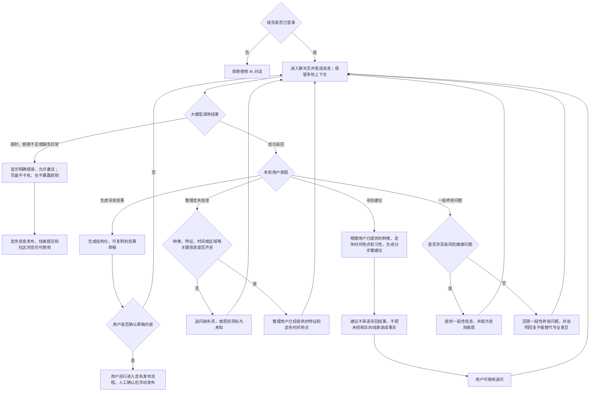

# PawFind 核心业务流程

> 依据：`docs/requirements.md` v1.0  
> 阶段：W1D1 需求分析  
> 范围：宠物走失与寻回、社区帖子发布与管理员审核、AI 寻宠对话

三条流程只描述已确定的业务规则。发现记录与走失记录相互独立。社区帖子先审后发。AI 生成的启事由用户确认后手动发布。

## 1. 宠物走失与寻回

主人发布走失信息后，其他居民可以浏览，并提交目击线索或另行发布发现记录。主人核实线索后，线下自行确认，再把走失状态标记为已寻回。系统负责交换线索，不保证寻回成功。

补充规则：

- 走失记录和发现记录都只能由发布者编辑。
- 线索必须属于一条有效且处于寻找中的走失记录。
- 联系信息需经本人授权后可见，或通过站内线索转达。首版不新增独立的联系人交换功能。

## 2. 社区帖子发布与管理员审核

新帖初始为 `PENDING`，审核通过前不公开。审核状态与展示状态分开判断。普通成员只能看到 `APPROVED + VISIBLE` 的帖子。

状态结果：

| 审核状态 | 展示状态 | 对普通登录用户 | 对作者 |
| --- | --- | --- | --- |
| `PENDING` | — | 不可见，也不能评论 | 可在我的帖子查看 |
| `REJECTED` | — | 不可见，也不能评论 | 可查看驳回原因，修改后重新提交 |
| `APPROVED` | `VISIBLE` | 可浏览、搜索、查看详情和评论 | 可查看；修改正文或图片后重新审核 |
| `APPROVED` | `HIDDEN` | 不可见，也不能评论 | 可查看隐藏原因 |

隐藏不能代替审核。只有已经通过审核的帖子可以由 `HIDDEN` 恢复为 `VISIBLE`。

## 3. AI 寻宠对话

登录成员通过多轮对话获得寻宠建议、信息整理、启事草稿或一般养宠回答。模型不可用时，只影响 AI 对话，不影响走失发布和社区浏览。

AI 约束：

- 只依据用户已经提供的信息生成建议和启事。
- 缺失信息继续询问或标为未知。
- 启事草稿停止在可复制文本，发布动作由用户完成。
- 首版 AI 不查询业务数据、不执行审核，也不删除或隐藏内容。
- 大模型 API Key 只放在服务端配置中。
